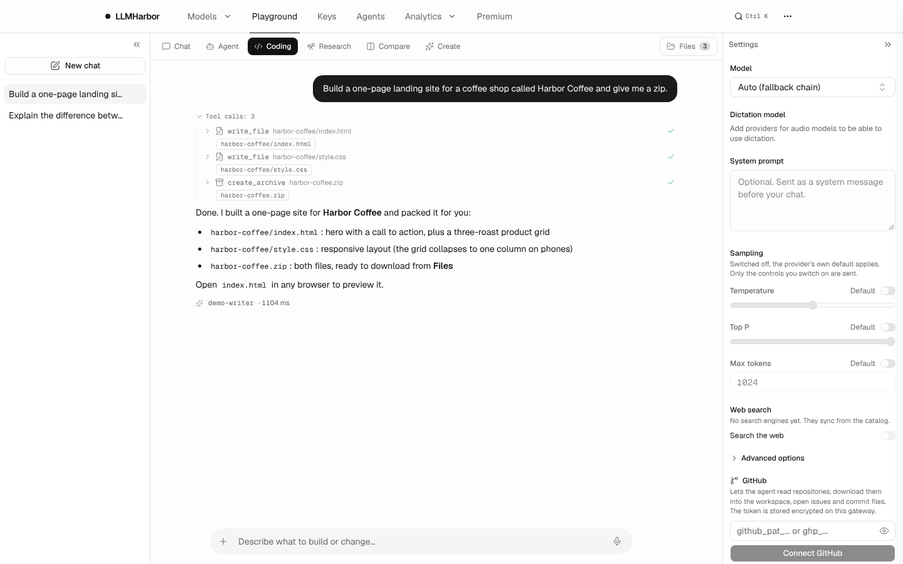

<div align="center">

# LLMHarbor

A self-hosted gateway that puts the free tiers of many LLM API providers behind one
OpenAI-compatible endpoint.

LLMHarbor is a modified version of [freellmapi](https://github.com/tashfeenahmed/freellmapi/) by
Tashfeen Ahmed, maintained by Zelvior Labs.

[](https://github.com/Zelvior-Labs/llmharbor/actions/workflows/ci.yml)
[](./LICENSE)

**English** · [Türkçe](README.tr.md) · [简体中文](README.zh-cn.md) · [Русский](README.ru.md) · [O'zbekcha](README.uz.md)

[Website](https://llmharbor.vercel.app) · [Downloads](https://github.com/Zelvior-Labs/llmharbor/releases) · [Documentation](docs/en/README.md)

</div>

## What it does

- **One API, many providers.** You add keys for the providers you use. The dashboard's Keys page
  offers 84 provider platforms, 9 web-search providers, and custom OpenAI-compatible endpoints
  (llama.cpp, LM Studio, vLLM, Ollama, other gateways). See [Providers](docs/en/providers.md).
- **Routing and failover.** For each request the router picks a model with a healthy key that is under
  its rate limits. If a provider returns 429 or 5xx, times out, or stalls, the router cools that
  model/key down and tries the next candidate. A successful response names the model that served it
  in `X-Routed-Via`.
- **Several wire formats.** OpenAI-compatible `/v1` (chat, completions, Responses, embeddings,
  rerank, moderation, images, video, speech, transcription, search), Anthropic Messages
  (`/v1/messages`), Gemini (`/v1beta`), optional Ollama emulation (`/api/*`) and an MCP endpoint
  (`/mcp`). See [API](docs/en/api.md).
- **Model selection.** Use `auto`, an `auto:smart|fast|reliable|balanced|cheap` sort, a named
  fallback chain (`auto:<name>`), `fusion` (several models answer, then a judge model combines the
  answers), or a specific model id.
- **Keys stay local.** Provider keys are stored AES-256-GCM-encrypted in SQLite on your machine.
  Clients only see one unified `llmharbor-…` key, or client-profile keys and revocable URL tokens
  that you create.
- **Dashboard.** Manage keys, models and fallback chains. It also has a playground, analytics,
  logs and backups. The dashboard UI ships in 60 locales.
- **Playground modes.** Chat directly, or let an agent work with tools in Agent, Coding and Research
  modes: it writes files, builds zip/tar archives, searches the web, generates images, video and
  speech, searches your knowledge files and uses GitHub. Compare runs one prompt on up to four
  models side by side. The router (`auto`) is the default; any model can be picked instead. Works
  in the desktop apps and phone browsers. See [Playground](docs/en/playground.md).
- **Coding-agent setup.** `npm run cli -- setup-<tool>` writes the config for Claude Code, Codex CLI,
  Cline, Continue, Aider, OpenCode, Qwen Code and more. See [Agents and CLI](docs/en/agents.md).

## Screenshots

Captured from a local build of the dashboard, routing to a local OpenAI-compatible test server.

<table>
<tr>
<td width="50%"><br><sub>Models: routing strategy and live scores</sub></td>
<td width="50%"><br><sub>Playground: Chat mode, a reply with the model that served it</sub></td>
</tr>
<tr>
<td><br><sub>Analytics: requests, latency and tokens</sub></td>
<td><br><sub>Agents: setup commands for coding tools</sub></td>
</tr>
<tr>
<td><br><sub>Playground: Coding mode, the agent wrote files and zipped them</sub></td>
<td><br><sub>Playground: Compare mode, two models side by side</sub></td>
</tr>
</table>

## Get it

| Platform | Download | Guide |
| --- | --- | --- |
| Windows 10/11, macOS 12+, Linux x64/arm64 | [Latest release](https://github.com/Zelvior-Labs/llmharbor/releases/latest) (`v*`) | [Desktop](docs/en/desktop.md) |
| Windows 7 / 8 / 8.1 | `-windows-legacy-*` installer or portable ZIP in the [`v*` releases](https://github.com/Zelvior-Labs/llmharbor/releases/latest) | [desktop/win7](desktop/win7/README.md) |
| Linux Legacy (x86/x64, Node.js 18+) | `-linux-legacy-*` .deb, AppImage or portable in the [`v*` releases](https://github.com/Zelvior-Labs/llmharbor/releases/latest) | [desktop/linux-browser](desktop/linux-browser/README.md) |
| Android 8.0+ | `-android-*.apk` in the [`v*` releases](https://github.com/Zelvior-Labs/llmharbor/releases/latest) | [Android](docs/en/android.md) |
| Docker | Build from this repo, or `ghcr.io/zelvior-labs/llmharbor` | [Docker](docs/en/docker.md) |
| Node.js (source) | `git clone` | [Install](docs/en/install.md) |

## Quick start from source

Requires Node.js `>=20.18.0 <25.0.0` and npm 10+.

```bash
git clone https://github.com/Zelvior-Labs/llmharbor.git
cd llmharbor
npm install
npm run dev
```

This starts the API on port 3001 and the dashboard on <http://localhost:5173>. Then:

1. Create the first account in the dashboard.
2. Add provider keys on **Keys**.
3. Copy the unified API key from **Keys → Unified API key**.

For a production build, Docker, LAN access and the first-run setup code, see
[Install](docs/en/install.md).

## Use it

```python
from openai import OpenAI

client = OpenAI(base_url="http://localhost:3001/v1", api_key="llmharbor-...")
resp = client.chat.completions.create(
    model="auto",
    messages=[{"role": "user", "content": "Summarise the fall of Rome in one sentence."}],
)
print(resp.choices[0].message.content)
```

The desktop and Android apps listen on `http://127.0.0.1:31415` by default.

Configure a coding agent from your checkout. The CLI is not published to npm:

```bash
npm run cli -- setup-claude --url http://localhost:3001 --api-key llmharbor-...
```

## Documentation

[Install](docs/en/install.md) · [Configuration](docs/en/configuration.md) ·
[Providers](docs/en/providers.md) · [API](docs/en/api.md) · [Playground](docs/en/playground.md) · [Agents and CLI](docs/en/agents.md) ·
[Desktop](docs/en/desktop.md) · [Android](docs/en/android.md) · [Docker](docs/en/docker.md) ·
[Networking](docs/en/networking.md) · [Architecture](docs/en/architecture.md) ·
[Troubleshooting](docs/en/troubleshooting.md)

## Limitations

- Free tiers are controlled by the providers. Quotas, models and terms change without notice. Check
  each provider's current terms; they still apply when traffic goes through this gateway.
- Latency varies, and there is no SLA. When the strongest models run out of daily quota, requests
  fall through to whatever is still available until the counters reset at UTC midnight.
- LLMHarbor is single-user and meant for trusted networks. Its API is protected only by the unified
  key, so don't expose it directly to the internet.
- The model catalog syncs from `api.freellmapi.co`. Set `CATALOG_SYNC_DISABLED=1` to use only the
  catalog bundled with the build. See [Providers](docs/en/providers.md#model-catalog).

This project is for personal experimentation and learning. If you build something that matters on
top of it, use a paid API.

## Paid plans

LLMHarbor has no paid plan. Everything in this repository is free under the MIT license.

The original project, freellmapi, offers an optional paid plan at
[freellmapi.co](https://freellmapi.co/#pricing). The dashboard's **Premium** page and the `license` config
field come from freellmapi's code. LLMHarbor doesn't sell license keys, so a standard install uses
the free monthly snapshot of the signed catalog.

P.S. If you want to pay for it, use the original tool, which is available at
[freellmapi.co](https://freellmapi.co/).

## Contributing and security

- [CONTRIBUTING.md](CONTRIBUTING.md): development loop, tests, migrations, translations.
- [SECURITY.md](SECURITY.md): how to report a vulnerability.
- Questions and bug reports: [GitHub issues](https://github.com/Zelvior-Labs/llmharbor/issues) or
  [zelvior@proton.me](mailto:zelvior@proton.me).

## License

[MIT](./LICENSE)
