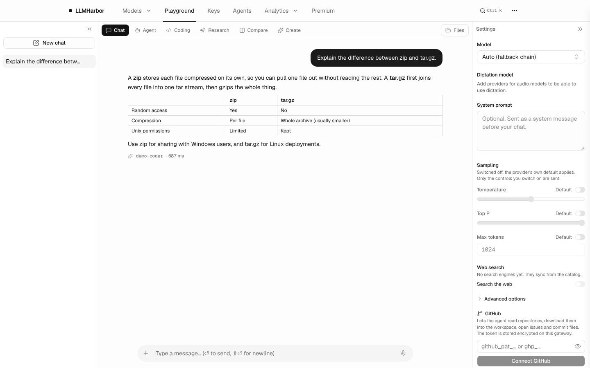
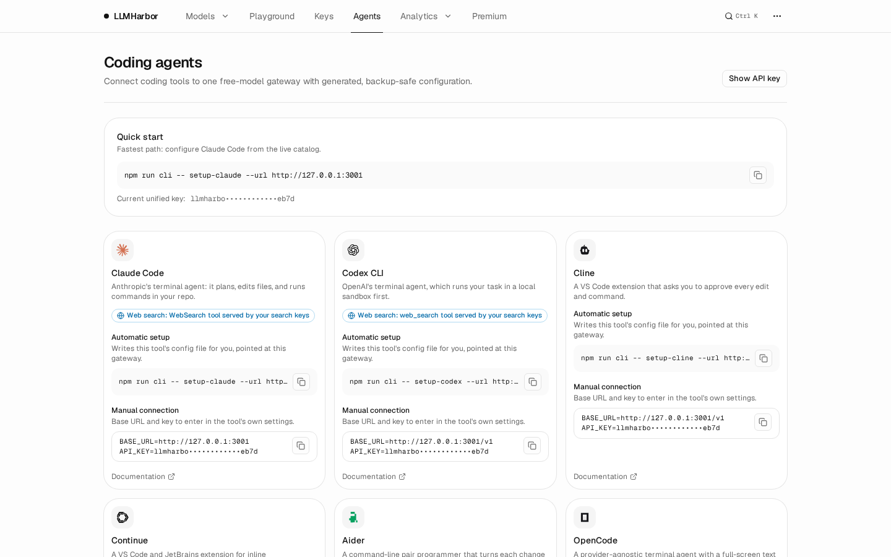

<div align="center">

# LLMHarbor

Самостоятельно размещаемый шлюз, который объединяет бесплатные тарифы многих поставщиков LLM API за
одной OpenAI-совместимой точкой доступа.

LLMHarbor — модифицированная версия [freellmapi](https://github.com/tashfeenahmed/freellmapi/) Ташфина
Ахмеда (Tashfeen Ahmed), которую поддерживает Zelvior Labs.

[](https://github.com/Zelvior-Labs/llmharbor/actions/workflows/ci.yml)
[](./LICENSE)

[English](README.md) · [Türkçe](README.tr.md) · [简体中文](README.zh-cn.md) · **Русский** · [O'zbekcha](README.uz.md)

[Сайт](https://llmharbor.vercel.app) · [Загрузки](https://github.com/Zelvior-Labs/llmharbor/releases) · [Документация (англ.)](docs/en/README.md)

</div>

## Возможности

- **Один API, много поставщиков.** Вы добавляете ключи тех поставщиков, которыми пользуетесь. Страница
  Keys в панели управления предлагает 84 платформы, 9 поставщиков веб-поиска и пользовательские
  OpenAI-совместимые эндпоинты (llama.cpp, LM Studio, vLLM, Ollama, другие шлюзы). См.
  [Providers](docs/en/providers.md).
- **Маршрутизация и отказоустойчивость.** Для каждого запроса маршрутизатор выбирает модель, у которой есть
  исправный ключ в пределах лимитов. Если поставщик возвращает 429 или 5xx, не отвечает вовремя или
  зависает, маршрутизатор отправляет эту пару модель/ключ на «остывание» и пробует следующего кандидата.
  Успешный ответ указывает обслужившую его модель в заголовке `X-Routed-Via`.
- **Несколько протоколов.** OpenAI-совместимый `/v1` (чат, completions, Responses, эмбеддинги, rerank,
  модерация, изображения, видео, синтез и распознавание речи, поиск), Anthropic Messages (`/v1/messages`),
  Gemini (`/v1beta`), необязательная эмуляция Ollama (`/api/*`) и эндпоинт MCP (`/mcp`). См.
  [API](docs/en/api.md).
- **Выбор модели.** `auto`, сортировка `auto:smart|fast|reliable|balanced|cheap`, именованная цепочка
  (`auto:<name>`), `fusion` (несколько моделей отвечают, затем модель-судья объединяет ответы) или
  конкретный идентификатор модели.
- **Ключи остаются у вас.** Ключи поставщиков хранятся в SQLite на вашей машине в зашифрованном виде
  (AES-256-GCM). Клиенты видят только один общий ключ `llmharbor-…` либо созданные вами ключи
  клиентских профилей и отзываемые URL-токены.
- **Панель управления.** Управление ключами, моделями и цепочками, а также playground, аналитика, журналы и
  резервные копии. Интерфейс доступен на 60 языках.
- **Режимы Playground.** Обычный чат или агент с инструментами в режимах Agent, Coding и Research:
  он пишет файлы, собирает архивы zip/tar, ищет в интернете, генерирует изображения, видео и речь,
  ищет по вашим файлам знаний и работает с GitHub. Compare отправляет один запрос сразу нескольким
  моделям (до четырёх). По умолчанию используется маршрутизатор (`auto`), но можно выбрать любую
  модель. Работает в настольных приложениях и в браузере телефона. См.
  [Playground](docs/en/playground.md).
- **Настройка агентов для программирования.** `npm run cli -- setup-<tool>` записывает конфигурацию для
  Claude Code, Codex CLI, Cline, Continue, Aider, OpenCode, Qwen Code и других. См.
  [Agents and CLI](docs/en/agents.md).

## Скриншоты

Сняты с локальной сборки панели управления, которая направляет запросы на локальный OpenAI-совместимый тестовый сервер.

<table>
<tr>
<td width="50%"><br><sub>Models: стратегия маршрутизации и текущие оценки</sub></td>
<td width="50%"><br><sub>Playground: режим Chat, ответ и модель, которая его дала</sub></td>
</tr>
<tr>
<td><br><sub>Analytics: запросы, задержка и токены</sub></td>
<td><br><sub>Agents: команды настройки для инструментов разработки</sub></td>
</tr>
<tr>
<td><br><sub>Playground: режим Coding, агент написал файлы и упаковал их в zip</sub></td>
<td><br><sub>Playground: режим Compare, две модели рядом</sub></td>
</tr>
</table>

## Где взять

| Платформа | Загрузка | Руководство |
| --- | --- | --- |
| Windows 10/11, macOS 12+, Linux x64 | [Releases](https://github.com/Zelvior-Labs/llmharbor/releases) (`v*`) | [Desktop](docs/en/desktop.md) |
| Windows 7 SP1 | [Releases](https://github.com/Zelvior-Labs/llmharbor/releases?q=win7) (`win7-v*`, пререлиз) | [desktop/win7](desktop/win7/README.md) |
| 32-битный Intel Linux | `-linux-i686-server.tar.gz` в релизах `v*` | [desktop/linux-browser](desktop/linux-browser/README.md) |
| Android 8.0+ | [Releases](https://github.com/Zelvior-Labs/llmharbor/releases?q=android) (`android-v*`, пререлиз) | [Android](docs/en/android.md) |
| Docker | Сборка из этого репозитория или `ghcr.io/zelvior-labs/llmharbor` | [Docker](docs/en/docker.md) |
| Node.js (исходный код) | `git clone` | [Install](docs/en/install.md) |

## Быстрый старт из исходного кода

Нужны Node.js `>=20.18.0 <25.0.0` и npm 10+.

```bash
git clone https://github.com/Zelvior-Labs/llmharbor.git
cd llmharbor
npm install
npm run dev
```

API запустится на порту 3001, панель управления — на <http://localhost:5173>. Затем:

1. Создайте первую учётную запись в панели управления.
2. Добавьте ключи поставщиков на странице **Keys**.
3. Скопируйте общий API-ключ в **Keys → Unified API key**.

Продакшен-сборка, Docker, доступ из локальной сети и одноразовый код первой настройки описаны в
[Install](docs/en/install.md).

## Использование

```python
from openai import OpenAI

client = OpenAI(base_url="http://localhost:3001/v1", api_key="llmharbor-...")
resp = client.chat.completions.create(
    model="auto",
    messages=[{"role": "user", "content": "Опиши падение Рима одним предложением."}],
)
print(resp.choices[0].message.content)
```

Настольное приложение и приложение для Android по умолчанию слушают `http://127.0.0.1:31415`.

Настройка агента из клонированного репозитория (CLI не публикуется в npm):

```bash
npm run cli -- setup-claude --url http://localhost:3001 --api-key llmharbor-...
```

## Документация (на английском)

[Install](docs/en/install.md) · [Configuration](docs/en/configuration.md) ·
[Providers](docs/en/providers.md) · [API](docs/en/api.md) · [Playground](docs/en/playground.md) · [Agents and CLI](docs/en/agents.md) ·
[Desktop](docs/en/desktop.md) · [Android](docs/en/android.md) · [Docker](docs/en/docker.md) ·
[Networking](docs/en/networking.md) · [Architecture](docs/en/architecture.md) ·
[Troubleshooting](docs/en/troubleshooting.md)

## Ограничения

- Бесплатные тарифы контролируют сами поставщики: квоты, модели и условия меняются без предупреждения.
  Проверяйте актуальные условия каждого поставщика — они действуют и при работе через этот шлюз.
- Задержка непостоянна, SLA нет. Когда у самых сильных моделей заканчивается дневная квота, запросы уходят
  к тем, что ещё доступны, пока счётчики не сбросятся в полночь по UTC.
- LLMHarbor рассчитан на одного пользователя и доверенную сеть. API защищён только общим ключом, поэтому не
  открывайте его напрямую в интернет.
- Каталог моделей синхронизируется с `api.freellmapi.co`. Установите `CATALOG_SYNC_DISABLED=1`, чтобы
  использовать только каталог, встроенный в сборку. См. [Providers](docs/en/providers.md#model-catalog).

Проект предназначен для личных экспериментов и обучения. Если вы строите на нём что-то важное,
используйте платный API.

## Платные планы

У LLMHarbor нет платного плана. Всё в этом репозитории бесплатно и распространяется по лицензии MIT.

Исходный проект, freellmapi, предлагает необязательный платный план на
[freellmapi.co](https://freellmapi.co/#pricing). Страница **Premium** в панели управления и поле `license` в
конфигурации пришли из кода freellmapi. LLMHarbor не продаёт лицензионные ключи, поэтому обычная установка
использует бесплатный ежемесячный снимок подписанного каталога.

P.S. Если вы хотите за это платить, используйте оригинальный инструмент, он доступен по адресу
[freellmapi.co](https://freellmapi.co/).

## Участие и безопасность

- [CONTRIBUTING.md](CONTRIBUTING.md): цикл разработки, тесты, миграции, переводы.
- [SECURITY.md](SECURITY.md): как сообщить об уязвимости.
- Вопросы и сообщения об ошибках: [GitHub issues](https://github.com/Zelvior-Labs/llmharbor/issues) или
  [zelvior@proton.me](mailto:zelvior@proton.me).

## Лицензия

[MIT](./LICENSE)
