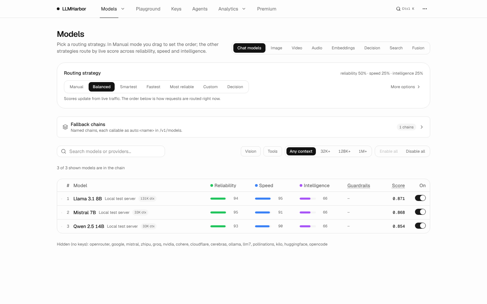

<div align="center">

# LLMHarbor

Birçok LLM API sağlayıcısının ücretsiz katmanlarını tek bir OpenAI uyumlu uç noktanın arkasında
toplayan, kendi sunucunuzda çalışan bir ağ geçidi.

LLMHarbor, Tashfeen Ahmed'in [freellmapi](https://github.com/tashfeenahmed/freellmapi/) projesinin
değiştirilmiş bir sürümüdür ve Zelvior Labs tarafından sürdürülmektedir.

[](https://github.com/Zelvior-Labs/llmharbor/actions/workflows/ci.yml)
[](./LICENSE)

[English](README.md) · **Türkçe** · [简体中文](README.zh-cn.md) · [Русский](README.ru.md) · [O'zbekcha](README.uz.md)

[Web sitesi](https://llmharbor.vercel.app) · [İndirmeler](https://github.com/Zelvior-Labs/llmharbor/releases) · [Belgeler (İngilizce)](docs/en/README.md)

</div>

## Ne yapar

- **Tek API, çok sağlayıcı.** Kullandığınız sağlayıcıların anahtarlarını eklersiniz. Paneldeki Keys
  sayfası 84 sağlayıcı platformu, 9 web arama sağlayıcısı ve özel OpenAI uyumlu uç noktalar (llama.cpp,
  LM Studio, vLLM, Ollama, diğer ağ geçitleri) sunar. Bkz. [Providers](docs/en/providers.md).
- **Yönlendirme ve yedeğe geçiş.** Yönlendirici her istek için sağlıklı bir anahtarı olan ve hız
  sınırlarının altında kalan bir model seçer. Sağlayıcı 429 veya 5xx döndürürse, zaman aşımına uğrarsa ya
  da takılırsa, o model/anahtar çiftini bekleme süresine alır ve sıradaki adayı dener. Başarılı bir yanıt,
  onu karşılayan modeli `X-Routed-Via` başlığında belirtir.
- **Birden çok protokol.** OpenAI uyumlu `/v1` (sohbet, completions, Responses, embedding, rerank,
  moderasyon, görsel, video, konuşma sentezi, transkripsiyon, arama), Anthropic Messages (`/v1/messages`),
  Gemini (`/v1beta`), isteğe bağlı Ollama öykünmesi (`/api/*`) ve bir MCP uç noktası (`/mcp`). Bkz.
  [API](docs/en/api.md).
- **Model seçimi.** `auto`, `auto:smart|fast|reliable|balanced|cheap` sıralaması, adlandırılmış bir yedek
  zinciri (`auto:<name>`), `fusion` (birkaç model yanıt verir, ardından bir hakem model yanıtları
  birleştirir) veya belirli bir model kimliği.
- **Anahtarlar sizde kalır.** Sağlayıcı anahtarları makinenizdeki SQLite'ta AES-256-GCM ile şifrelenmiş
  olarak saklanır. İstemciler yalnızca tek bir birleşik `llmharbor-…` anahtarını ya da sizin
  oluşturduğunuz istemci profili anahtarlarını ve iptal edilebilir URL belirteçlerini görür.
- **Panel.** Anahtarları, modelleri ve yedek zincirlerini yönetin; playground, analiz, günlükler ve
  yedekler de vardır. Panel arayüzü 60 dilde sunulur.
- **Kodlama ajanı kurulumu.** `npm run cli -- setup-<tool>` Claude Code, Codex CLI, Cline, Continue,
  Aider, OpenCode, Qwen Code ve diğerleri için yapılandırmayı yazar. Bkz.
  [Agents and CLI](docs/en/agents.md).

## Ekran görüntüleri

Panelin yerel bir derlemesinden alındı; istekler yerel, OpenAI uyumlu bir test sunucusuna yönlendiriliyor.

<table>
<tr>
<td width="50%"><br><sub>Models: yönlendirme stratejisi ve canlı puanlar</sub></td>
<td width="50%"><br><sub>Playground: yanıt ve onu üreten model</sub></td>
</tr>
<tr>
<td><br><sub>Analytics: istekler, gecikme ve token</sub></td>
<td><br><sub>Agents: kodlama araçları için kurulum komutları</sub></td>
</tr>
</table>

## Edinin

| Platform | İndirme | Kılavuz |
| --- | --- | --- |
| Windows 10/11, macOS 12+, Linux x64 | [Releases](https://github.com/Zelvior-Labs/llmharbor/releases) (`v*`) | [Desktop](docs/en/desktop.md) |
| Windows 7 SP1 | [Releases](https://github.com/Zelvior-Labs/llmharbor/releases?q=win7) (`win7-v*`, ön sürüm) | [desktop/win7](desktop/win7/README.md) |
| 32 bit Intel Linux | `v*` sürümlerindeki `-linux-i686-server.tar.gz` | [desktop/linux-browser](desktop/linux-browser/README.md) |
| Android 8.0+ | [Releases](https://github.com/Zelvior-Labs/llmharbor/releases?q=android) (`android-v*`, ön sürüm) | [Android](docs/en/android.md) |
| Docker | Bu depodan derleyin veya `ghcr.io/zelvior-labs/llmharbor` | [Docker](docs/en/docker.md) |
| Node.js (kaynak) | `git clone` | [Install](docs/en/install.md) |

## Kaynaktan hızlı başlangıç

Node.js `>=20.18.0 <25.0.0` ve npm 10+ gerekir.

```bash
git clone https://github.com/Zelvior-Labs/llmharbor.git
cd llmharbor
npm install
npm run dev
```

Bu, API'yi 3001 numaralı bağlantı noktasında, paneli <http://localhost:5173> adresinde başlatır. Sonra:

1. Panelde ilk hesabı oluşturun.
2. **Keys** sayfasında sağlayıcı anahtarlarını ekleyin.
3. Birleşik API anahtarını **Keys → Unified API key** bölümünden kopyalayın.

Üretim derlemesi, Docker, yerel ağ erişimi ve ilk çalıştırma kurulum kodu için bkz.
[Install](docs/en/install.md).

## Kullanım

```python
from openai import OpenAI

client = OpenAI(base_url="http://localhost:3001/v1", api_key="llmharbor-...")
resp = client.chat.completions.create(
    model="auto",
    messages=[{"role": "user", "content": "Roma'nın çöküşünü tek cümleyle özetle."}],
)
print(resp.choices[0].message.content)
```

Masaüstü ve Android uygulamaları varsayılan olarak `http://127.0.0.1:31415` adresini dinler.

Bir kodlama ajanını klonladığınız depodan yapılandırın (CLI npm'de yayımlanmaz):

```bash
npm run cli -- setup-claude --url http://localhost:3001 --api-key llmharbor-...
```

## Belgeler (İngilizce)

[Install](docs/en/install.md) · [Configuration](docs/en/configuration.md) ·
[Providers](docs/en/providers.md) · [API](docs/en/api.md) · [Agents and CLI](docs/en/agents.md) ·
[Desktop](docs/en/desktop.md) · [Android](docs/en/android.md) · [Docker](docs/en/docker.md) ·
[Networking](docs/en/networking.md) · [Architecture](docs/en/architecture.md) ·
[Troubleshooting](docs/en/troubleshooting.md)

## Sınırlamalar

- Ücretsiz katmanları sağlayıcılar kontrol eder; kotalar, modeller ve koşullar haber verilmeden değişir.
  Her sağlayıcının güncel koşullarını kontrol edin; trafik bu ağ geçidinden geçse de geçerlidir.
- Gecikme değişkendir ve SLA yoktur. En güçlü modellerin günlük kotası bittiğinde istekler, sayaçlar UTC
  gece yarısında sıfırlanana kadar hâlâ kullanılabilir olan modellere düşer.
- LLMHarbor tek kullanıcılıdır ve güvenilir ağlar içindir. API'si yalnızca birleşik anahtarla korunur; onu
  doğrudan internete açmayın.
- Model kataloğu `api.freellmapi.co` ile eşitlenir. Yalnızca derlemeyle gelen kataloğu kullanmak için
  `CATALOG_SYNC_DISABLED=1` ayarlayın. Bkz. [Providers](docs/en/providers.md#model-catalog).

Bu proje kişisel deneme ve öğrenme içindir. Üzerine önemli bir şey inşa ediyorsanız ücretli bir API
kullanın.

## Ücretli planlar

LLMHarbor'ın ücretli bir planı yoktur. Bu depodaki her şey MIT lisansı altında ücretsizdir.

Asıl proje olan freellmapi, [freellmapi.co](https://freellmapi.co/#pricing) adresinde isteğe bağlı bir ücretli
plan sunar. Paneldeki **Premium** sayfası ve yapılandırmadaki `license` alanı freellmapi'nin kodundan
gelir. LLMHarbor lisans anahtarı satmaz, bu yüzden standart bir kurulum imzalı kataloğun ücretsiz aylık
anlık görüntüsünü kullanır.

Not: Bunun için ödeme yapmak istiyorsanız orijinal aracı kullanın:
[freellmapi.co](https://freellmapi.co/).

## Katkı ve güvenlik

- [CONTRIBUTING.md](CONTRIBUTING.md): geliştirme döngüsü, testler, migration'lar, çeviriler.
- [SECURITY.md](SECURITY.md): güvenlik açığı nasıl bildirilir.
- Sorular ve hata bildirimleri: [GitHub issues](https://github.com/Zelvior-Labs/llmharbor/issues) veya
  [zelvior@proton.me](mailto:zelvior@proton.me).

## Lisans

[MIT](./LICENSE)
