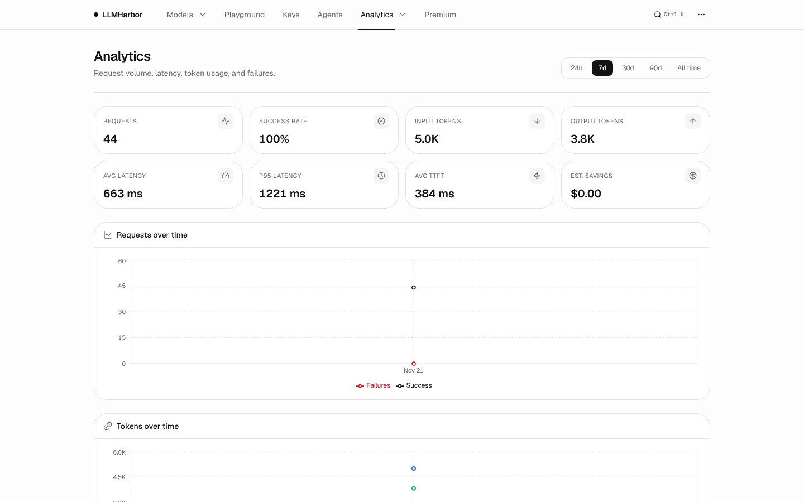

<div align="center">

# LLMHarbor

Ko'plab LLM API provayderlarining bepul tariflarini bitta OpenAI bilan mos endpoint ortida
birlashtiradigan, o'z serveringizda ishlaydigan shlyuz.

LLMHarbor — Tashfeen Ahmedning [freellmapi](https://github.com/tashfeenahmed/freellmapi/) loyihasining
o'zgartirilgan versiyasi bo'lib, uni Zelvior Labs qo'llab-quvvatlaydi.

[](https://github.com/Zelvior-Labs/llmharbor/actions/workflows/ci.yml)
[](./LICENSE)

[English](README.md) · [Türkçe](README.tr.md) · [简体中文](README.zh-cn.md) · [Русский](README.ru.md) · **O'zbekcha**

[Veb-sayt](https://llmharbor.vercel.app) · [Yuklab olish](https://github.com/Zelvior-Labs/llmharbor/releases) · [Hujjatlar (inglizcha)](docs/en/README.md)

</div>

## Nima qiladi

- **Bitta API, ko'p provayder.** Siz foydalanadigan provayderlarning kalitlarini qo'shasiz. Boshqaruv
  panelidagi Keys sahifasi 84 ta provayder platformasi, 9 ta veb-qidiruv provayderi va maxsus OpenAI bilan
  mos endpointlarni (llama.cpp, LM Studio, vLLM, Ollama, boshqa shlyuzlar) taklif qiladi. Qarang:
  [Providers](docs/en/providers.md).
- **Marshrutlash va zaxiraga o'tish.** Har bir so'rov uchun marshrutizator sog'lom kaliti bor va tezlik
  cheklovlaridan oshmagan modelni tanlaydi. Provayder 429 yoki 5xx qaytarsa, vaqti tugasa yoki qotib qolsa,
  marshrutizator o'sha model/kalit juftligini vaqtincha to'xtatib, keyingi nomzodni sinaydi. Muvaffaqiyatli
  javob uni bergan modelni `X-Routed-Via` sarlavhasida ko'rsatadi.
- **Bir nechta protokol.** OpenAI bilan mos `/v1` (chat, completions, Responses, embeddinglar, rerank,
  moderatsiya, rasm, video, nutq sintezi, transkripsiya, qidiruv), Anthropic Messages (`/v1/messages`),
  Gemini (`/v1beta`), ixtiyoriy Ollama emulyatsiyasi (`/api/*`) va MCP endpointi (`/mcp`). Qarang:
  [API](docs/en/api.md).
- **Model tanlash.** `auto`, `auto:smart|fast|reliable|balanced|cheap` saralashi, nomlangan zaxira zanjiri
  (`auto:<name>`), `fusion` (bir nechta model javob beradi, so'ng hakam model javoblarni birlashtiradi) yoki
  aniq model identifikatori.
- **Kalitlar sizda qoladi.** Provayder kalitlari kompyuteringizdagi SQLite'da AES-256-GCM bilan
  shifrlangan holda saqlanadi. Mijozlar faqat bitta umumiy `llmharbor-…` kalitini yoki siz yaratgan mijoz
  profili kalitlari va bekor qilinadigan URL tokenlarini ko'radi.
- **Boshqaruv paneli.** Kalitlar, modellar va zaxira zanjirlarini boshqaring; playground, analitika,
  jurnallar va zaxira nusxalar ham bor. Panel interfeysi 60 tilda mavjud.
- **Playground rejimlari.** To'g'ridan-to'g'ri suhbatlashing yoki Agent, Coding va Research
  rejimlarida agentga vositalar bilan ishlashga ruxsat bering: u fayl yozadi, zip/tar arxivlar
  yaratadi, internetda qidiradi, rasm, video va nutq yaratadi, bilim fayllaringizdan qidiradi va
  GitHub bilan ishlaydi. Compare bitta so'rovni to'rttagacha modelda yonma-yon ishga tushiradi.
  Standart holatda marshrutizator (`auto`) ishlatiladi, istalgan modelni ham tanlash mumkin. Desktop
  ilovalarida va telefon brauzerida ishlaydi. Qarang: [Playground](docs/en/playground.md).
- **Dasturlash agentlarini sozlash.** `npm run cli -- setup-<tool>` Claude Code, Codex CLI, Cline,
  Continue, Aider, OpenCode, Qwen Code va boshqalar uchun konfiguratsiyani yozadi. Qarang:
  [Agents and CLI](docs/en/agents.md).

## Skrinshotlar

Panelning lokal yig'ilmasidan olingan; so'rovlar lokal OpenAI-mos test serveriga yo'naltiriladi.

<table>
<tr>
<td width="50%"><br><sub>Models: marshrutlash strategiyasi va jonli ballar</sub></td>
<td width="50%"><br><sub>Playground: Chat rejimi, javob va uni bergan model</sub></td>
</tr>
<tr>
<td><br><sub>Analytics: so'rovlar, kechikish va tokenlar</sub></td>
<td><br><sub>Agents: kod yozish vositalari uchun sozlash buyruqlari</sub></td>
</tr>
<tr>
<td><br><sub>Playground: Coding rejimi, agent fayllarni yozib, zip qildi</sub></td>
<td><br><sub>Playground: Compare rejimi, ikki model yonma-yon</sub></td>
</tr>
</table>

## Qayerdan olish mumkin

| Platforma | Yuklab olish | Qo'llanma |
| --- | --- | --- |
| Windows 10/11, macOS 12+, Linux x64 | [Releases](https://github.com/Zelvior-Labs/llmharbor/releases) (`v*`) | [Desktop](docs/en/desktop.md) |
| Windows 7 SP1 | [Releases](https://github.com/Zelvior-Labs/llmharbor/releases?q=win7) (`win7-v*`, dastlabki reliz) | [desktop/win7](desktop/win7/README.md) |
| 32 bitli Intel Linux | `v*` relizlaridagi `-linux-i686-server.tar.gz` | [desktop/linux-browser](desktop/linux-browser/README.md) |
| Android 8.0+ | [Releases](https://github.com/Zelvior-Labs/llmharbor/releases?q=android) (`android-v*`, dastlabki reliz) | [Android](docs/en/android.md) |
| Docker | Ushbu repozitoriydan yig'ing yoki `ghcr.io/zelvior-labs/llmharbor` | [Docker](docs/en/docker.md) |
| Node.js (manba kod) | `git clone` | [Install](docs/en/install.md) |

## Manba koddan tez boshlash

Node.js `>=20.18.0 <25.0.0` va npm 10+ kerak.

```bash
git clone https://github.com/Zelvior-Labs/llmharbor.git
cd llmharbor
npm install
npm run dev
```

Bu API'ni 3001-portda, boshqaruv panelini esa <http://localhost:5173> manzilida ishga tushiradi. So'ng:

1. Panelda birinchi hisobni yarating.
2. **Keys** sahifasida provayder kalitlarini qo'shing.
3. Umumiy API kalitini **Keys → Unified API key** bo'limidan nusxalang.

Production yig'ish, Docker, mahalliy tarmoqdan kirish va birinchi ishga tushirishdagi sozlash kodi haqida:
[Install](docs/en/install.md).

## Foydalanish

```python
from openai import OpenAI

client = OpenAI(base_url="http://localhost:3001/v1", api_key="llmharbor-...")
resp = client.chat.completions.create(
    model="auto",
    messages=[{"role": "user", "content": "Rimning qulashini bir jumlada tushuntirib ber."}],
)
print(resp.choices[0].message.content)
```

Desktop va Android ilovalari sukut bo'yicha `http://127.0.0.1:31415` manzilini tinglaydi.

Dasturlash agentini klonlangan repozitoriydan sozlang (CLI npm'da e'lon qilinmaydi):

```bash
npm run cli -- setup-claude --url http://localhost:3001 --api-key llmharbor-...
```

## Hujjatlar (inglizcha)

[Install](docs/en/install.md) · [Configuration](docs/en/configuration.md) ·
[Providers](docs/en/providers.md) · [API](docs/en/api.md) · [Playground](docs/en/playground.md) · [Agents and CLI](docs/en/agents.md) ·
[Desktop](docs/en/desktop.md) · [Android](docs/en/android.md) · [Docker](docs/en/docker.md) ·
[Networking](docs/en/networking.md) · [Architecture](docs/en/architecture.md) ·
[Troubleshooting](docs/en/troubleshooting.md)

## Cheklovlar

- Bepul tariflarni provayderlarning o'zi boshqaradi: kvotalar, modellar va shartlar ogohlantirishsiz
  o'zgaradi. Har bir provayderning amaldagi shartlarini tekshiring — trafik ushbu shlyuz orqali o'tganda ham
  ular amal qiladi.
- Kechikish o'zgaruvchan, SLA yo'q. Eng kuchli modellarning kunlik kvotasi tugaganda so'rovlar hisoblagichlar
  UTC yarim tunida nolga qaytguncha hali mavjud modellarga o'tadi.
- LLMHarbor bitta foydalanuvchi va ishonchli tarmoq uchun mo'ljallangan. Uning API'si faqat umumiy kalit
  bilan himoyalangan, shuning uchun uni to'g'ridan-to'g'ri internetga ochmang.
- Model katalogi `api.freellmapi.co` bilan sinxronlanadi. Faqat yig'ilma bilan kelgan katalogdan foydalanish
  uchun `CATALOG_SYNC_DISABLED=1` ni o'rnating. Qarang: [Providers](docs/en/providers.md#model-catalog).

Ushbu loyiha shaxsiy tajriba va o'rganish uchun. Uning ustida muhim narsa qursangiz, pullik API'dan
foydalaning.

## Pullik tariflar

LLMHarbor'ning pullik tarifi yo'q. Ushbu repozitoriyadagi hamma narsa MIT litsenziyasi ostida bepul.

Asl loyiha freellmapi [freellmapi.co](https://freellmapi.co/#pricing) saytida ixtiyoriy pullik tarifni taklif
qiladi. Paneldagi **Premium** sahifasi va konfiguratsiyadagi `license` maydoni freellmapi kodidan
kelgan. LLMHarbor litsenziya kalitlarini sotmaydi, shuning uchun oddiy o'rnatma imzolangan katalogning
bepul oylik nusxasidan foydalanadi.

P.S. Agar buning uchun pul to'lamoqchi bo'lsangiz, asl vositadan foydalaning:
[freellmapi.co](https://freellmapi.co/).

## Hissa qo'shish va xavfsizlik

- [CONTRIBUTING.md](CONTRIBUTING.md): ishlab chiqish sikli, testlar, migratsiyalar, tarjimalar.
- [SECURITY.md](SECURITY.md): zaiflik haqida qanday xabar berish.
- Savollar va xatolar haqida xabarlar: [GitHub issues](https://github.com/Zelvior-Labs/llmharbor/issues)
  yoki [zelvior@proton.me](mailto:zelvior@proton.me).

## Litsenziya

[MIT](./LICENSE)
