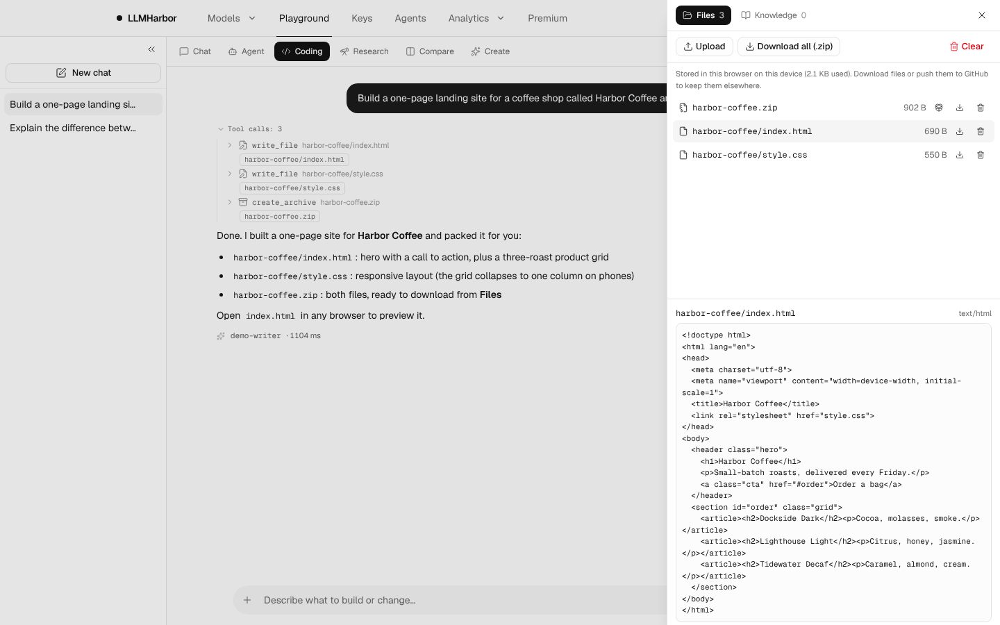
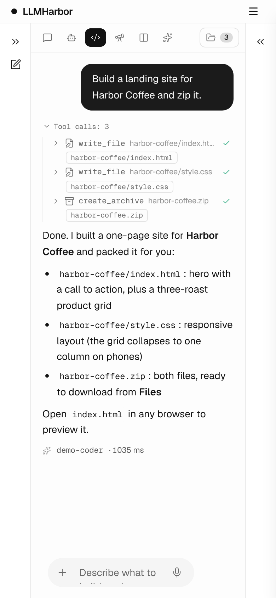

**English** · [简体中文](../zh-cn/playground.md)

# Playground

The **Playground** tab of the dashboard is where you talk to your models. A row of modes sits above
the transcript: plain chat, three agent modes that use tools, side-by-side comparison, and media
creation. Every mode sends its requests through this gateway's own `/v1` API with the unified key,
so routing, fallback, quotas and logs work exactly as they do for any other client.

Chat mode. The mode row is above the transcript; the settings rail is on the right.

## Modes

| Mode | What it does |
| --- | --- |
| **Chat** | Direct chat, one `/v1/chat/completions` request per message. This is the default and works as the Playground always has: streaming, reasoning, image attachments, web search and Fusion. |
| **Agent** | The model works step by step with tools (listed below) until the task is done, then replies with a summary. |
| **Coding** | Agent mode with extra instructions for software work: read before editing, write complete files, keep a sensible project layout, and pack the project with `create_archive` when asked or when it is finished. |
| **Research** | Agent mode with extra instructions to search the web several times, compare sources and answer with numbered citations. A report is also saved under `reports/` when you ask for one. |
| **Compare** | Sends one prompt to two to four models at once and streams their answers side by side. |
| **Create** | Generates an image, a video or speech straight from a prompt. |

The selected mode is remembered in the browser. When you open a saved conversation, the Playground
switches to the mode of its last agent reply, so a follow-up keeps working with tools.

### Choosing a model or the router

The **Model** picker in the settings rail applies to every mode. It defaults to **Auto (fallback
chain)**: the request goes out without a `model` field and the router picks a model, failing over as
usual. You can pick a named fallback chain, Fusion or any enabled model instead. This choice only
affects the Playground; your other clients keep sending whatever model they send.

In **Compare**, each column has its own picker (Auto and Fusion by default). **Add model** adds a
column, up to four. Each prompt is sent on its own, without the earlier rounds. Compare rounds are
not saved to the conversation list.

## Agent modes

Agent, Coding and Research run a tool loop in the browser. Each step is one non-streaming
`/v1/chat/completions` request that carries the tool definitions; the model either calls tools or
answers. A run stops when the model answers, when you press **Stop**, or after 30 tool rounds, in
which case the Playground says so and you can ask it to continue.

Coding mode: every tool call is listed with its arguments and result; file chips open the file.

Every reply shows its tool calls (expand one to see the arguments and the result) and the model that
served the last step. The steps are saved with the conversation, so they are still there when you
reopen it.

Tool calls need a model that supports them. With **Auto**, the gateway only routes requests that
carry tools to tool-capable models. If none is enabled, the run fails with a message pointing you to
the **Models** page.

### Tools

| Tool | Available when | What it does |
| --- | --- | --- |
| `list_files`, `read_file`, `write_file`, `edit_file`, `delete_file` | Always | Work with files in the workspace. |
| `create_archive`, `extract_archive` | Always | Create or unpack zip, tar and tar.gz archives in the workspace. |
| `web_search` | A web search engine is set up | Searches through `/v1/search`. |
| `generate_image` | An image model is enabled | `/v1/images/generations`; the image is saved in the workspace. |
| `generate_video` | A video model is enabled | `/v1/videos/generations`; the MP4 is saved in the workspace. |
| `text_to_speech` | A speech model is enabled | `/v1/audio/speech`; the audio is saved in the workspace. |
| `search_knowledge` | You added knowledge files | Returns the most relevant passages of your knowledge files. |
| `github_request`, `github_download_repo`, `github_push_files` | GitHub is connected | Call the GitHub REST API, download a repository into the workspace, commit workspace files to a branch. |

Only the tools that can work are offered to the model. Research mode shows a warning when no web
search engine is set up yet.

## Files and the workspace

The agent works in a **workspace**: a virtual folder stored in this browser's IndexedDB on this
device. Open it with **Files** at the end of the mode row.

The Files drawer: preview, download, extract, delete. Knowledge files have their own tab.

- **Upload** adds your own files. Files the agent writes, archives it creates and media from tools
  or Create mode appear here too.
- Text files, images, audio and video can be previewed in the drawer.
- Each file has a download button. **Download all (.zip)** downloads the whole workspace as one zip.
- Zip, tar and tar.gz files can be unpacked in place with **Extract here**.
- The workspace holds up to 2000 files and 200 MB, with up to 50 MB per file.

The workspace is not synced. Another browser or device has its own, and clearing the site data of
the dashboard deletes it. Download files, or push them to GitHub, to keep them elsewhere.
Conversations themselves are saved on the server as before.

## Knowledge files

The **Knowledge** tab of the Files drawer takes text files (up to 10 MB each) that the agent can
search with `search_knowledge`. Each file is split into overlapping passages. When your default
embedding family has an enabled provider with a key, the passages are embedded through
`/v1/embeddings` and searched by meaning; otherwise the Playground uses keyword search, and says so
when you add the file. Knowledge files are stored in the browser like the workspace.

## Create mode

Pick **Image**, **Video** or **Speech** above the transcript and type a prompt:

- **Image**: size 1024x1024, 1024x1792, 1792x1024 or 512x512.
- **Video**: length in seconds and 16:9 or 9:16. Video generation can take several minutes.
- **Speech**: an optional voice.

Results are saved in the workspace (`images/`, `videos/`, `audio/`) and shown inline. Until a
matching model is enabled on the media pages under **Models**, the Playground shows a note above the
transcript.

## Settings rail additions

- **Advanced options**: seed, top K, min P, frequency, presence and repetition penalties, up to four
  stop sequences, JSON output and reasoning effort. Each is sent only while it is switched on, and
  providers that do not support one ignore it. They apply to Chat, the agent modes and Compare.
- **GitHub**: paste a GitHub personal access token to let the agent use the GitHub tools. The token
  is checked against GitHub, stored encrypted on this gateway like provider keys, and never sent
  back to the browser. The browser cannot call `api.github.com` itself (the dashboard only talks to
  its own origin), so the gateway relays the agent's requests through
  `/api/playground/github`. The relay only reaches `api.github.com`, uses the outbound proxy when
  one is configured, and returns at most 25 MB per response. **Disconnect** deletes the token.

## Phones and other platforms

Everything runs in the dashboard page, so the Playground works wherever the dashboard opens: a
desktop browser, the desktop apps (including the Windows 7 build) and phone browsers. On Android,
**Open dashboard** opens it in the phone's browser. On narrow screens the mode row shows icons, and
downloads use the browser's normal download handling.

Coding mode on a 390 px wide phone screen.

## Compare screenshot

Compare mode: two columns, each streaming its own model's answer.
