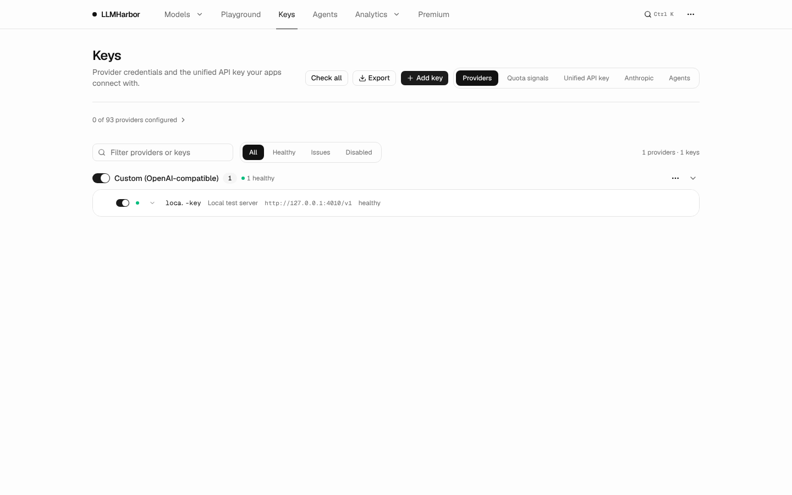

**English** · [简体中文](../zh-cn/providers.md)

# Providers

A *platform* is a named upstream service, such as `groq` or `openrouter`. The full list of platform
ids is the `Platform` type in [`shared/types.ts`](../../shared/types.ts). Each platform has an
adapter in [`server/src/providers/`](../../server/src/providers).

You add keys on the dashboard's **Keys** page, or from a terminal with
`npm run cli -- keys add <platform>` (see [Agents and CLI](agents.md#provider-keys)). Keys are
stored AES-256-GCM-encrypted in SQLite. A key can be enabled, disabled, scoped to specific models,
and health-checked.

## Chat, media and decision providers

The table below is generated from the `PLATFORMS` list in
[`client/src/components/keys/shared.tsx`](../../client/src/components/keys/shared.tsx), which is
what the Keys page offers. The labels are the ones the dashboard shows. Free allowances are set by
each provider and can change at any time, so check the provider's own page before you rely on one.
Two more platforms, `aclide` and `waterfall`, are marked `hidden` in that file. They are no longer
offered for new keys, but existing keys keep working.

| Platform id | Dashboard label | Key / signup page |
| --- | --- | --- |
| `agnes` | Agnes AI (free key) | <https://platform.agnes-ai.com> |
| `aihorde` | AI Horde (no key needed, slow) | <https://aihorde.net/register> |
| `ainative` | AINative Studio (free key) | <https://ainative.studio> |
| `aion` | Aion Labs (free key) | <https://www.aionlabs.ai> |
| `airforce` | Api.Airforce (daily free requests; 1 per minute) | <https://api.airforce> |
| `aisense` | AI SENSE (keyless decisions) | <https://www.aisense.no/free-public-api-decide-api-endpoint> |
| `anyapi` | AnyAPI (free key) | <https://anyapi.ai> |
| `apinex` | APINex (shared daily free chat and decisions) | <https://apinex.bond/keys> |
| `bai` | B.AI (promotional free model) | <https://b.ai> |
| `bazaarlink` | BazaarLink (free key) | <https://bazaarlink.ai> |
| `beatapi` | BeatAPI (JEV decisions; temporary free offer) | <https://beatapi.io> |
| `blaze` | BlazeAPI (daily free tokens; Discord verification) | <https://blazeapi.org/dashboard> |
| `blockrun` | BlockRun (zero-priced models) | <https://user.blockrun.ai/dashboard/keys> |
| `cartesia` | Cartesia (20K shared credits/month; non-commercial Free plan) | <https://play.cartesia.ai/keys> |
| `cerebras` | Cerebras | <https://cloud.cerebras.ai> |
| `clod` | CLōD (shared daily free requests) | <https://app.clod.io> |
| `cloudflare` | Cloudflare Workers AI | <https://dash.cloudflare.com> |
| `cohere` | Cohere | <https://dashboard.cohere.com/api-keys> |
| `dreamprompting` | DreamPrompting (rolling 24h free tokens and requests) | <https://dreamprompting.com> |
| `electronhub` | ElectronHub (shared weekly credits) | <https://app.electronhub.ai> |
| `experiential` | Experiential Labs (shared monthly credits) | <https://platform.experientiallabs.ai> |
| `freeai` | Free.ai (speech, transcription and embeddings) | <https://free.ai/account/#api-keys> |
| `freeinference` | FreeInference (research; requests logged) | <https://freeinference.org> |
| `freemodel` | FreeModel (monthly allowance; Telegram verification) | <https://freemodel.in/dashboard> |
| `freetts` | FreeTTS (personal use only; watermarked TTS) | <https://freetts.org/dashboard?section=api-keys> |
| `gizmo` | Gizmo (monthly free-model requests) | <https://gizmoplatforms.com/developers> |
| `google` | Google AI Studio | <https://aistudio.google.com/apikey> |
| `groq` | Groq | <https://console.groq.com/keys> |
| `halx` | HAL-X (keyless decisions) | <https://hal-x.ai> |
| `huggingface` | HuggingFace Router | <https://huggingface.co/settings/tokens> |
| `inferbase` | Inferbase (shared monthly and daily allowance) | <https://inferbase.ai> |
| `iteracompute` | IteraCompute (30M free tokens / month, shared) | <https://iteracompute.com/free/> |
| `jamai` | JamAI Base (monthly ELLM allowance) | <https://cloud.jamaibase.com> |
| `kenari` | Kenari (shared daily free chat and images) | <https://kenari.id> |
| `kilo` | Kilo Gateway (no key needed) | <https://app.kilo.ai> |
| `kiosapi` | KiosAPI (shared daily free chat) | <https://kiosapi.id/dashboard/keys> |
| `llm7` | LLM7 (anon ok) | <https://llm7.io> |
| `llmtr` | LLMTR (daily free-model quotas) | <https://llmtr.com> |
| `logfare` | Logfare (fair-use free models) | <https://logfare.ai> |
| `longcat` | LongCat (free daily, email signup ok) | <https://longcat.chat/platform> |
| `lucidity` | Lucidity Composite (daily free-model requests) | <https://composite.lucidity.sh> |
| `meldport` | Meldport (monthly free tokens) | <https://console.meldport.com> |
| `mistral` | Mistral | <https://console.mistral.ai/api-keys/> |
| `modelscope` | ModelScope (free key, needs Aliyun cn binding) | <https://modelscope.cn/my/myaccesstoken> |
| `moondream` | Moondream ($5 shared monthly credits) | <https://moondream.ai/c/cloud/api-keys> |
| `nabh` | nabh.cloud (50 shared monthly credits) | <https://app.nabh.cloud> |
| `nara` | NaraRouter (free key) | <https://router.bynara.id> |
| `navy` | NavyAI (free key) | <https://api.navy> |
| `novai` | NovAI (daily free chat + video quota) | <https://aiapi-pro.com> |
| `nvidia` | NVIDIA NIM | <https://build.nvidia.com/settings/api-keys> |
| `ollama` | Ollama Cloud | <https://ollama.com/settings/keys> |
| `onomeo` | onomeo (30 free calls / 5 hours, shared) | <https://onomeo.com/dashboard> |
| `opencode` | OpenCode Zen (paid models only) | <https://opencode.ai/auth> |
| `openrouter` | OpenRouter | <https://openrouter.ai/keys> |
| `orcarouter` | OrcaRouter (free key) | <https://www.orcarouter.ai> |
| `ovh` | OVH AI Endpoints (no key needed) | <https://endpoints.ai.cloud.ovh.net> |
| `plugsky` | Plugsky (free chat aliases) | <https://plugsky.com/dashboard> |
| `pollinations` | Pollinations | <https://enter.pollinations.ai> |
| `powertokens` | PowerTokens (free: glm-4.7-flash) | <https://www.powertokens.ai> |
| `qianfan` | Baidu Qianfan (free ERNIE, needs cn real-name) | <https://console.bce.baidu.com/qianfan/overview> |
| `radeon` | AMD Radeon Cloud (free shared models) | <https://developer.amd.com.cn/radeon/tokenfactory> |
| `reka` | Reka (prepaid credits) | <https://platform.reka.ai> |
| `requesty` | Requesty (free key) | <https://www.requesty.ai> |
| `rime` | Rime (shared monthly TTS / transcription credits) | <https://app.rime.ai> |
| `router9` | Router9 (shared monthly credits) | <https://www.router9.com> |
| `routeway` | Routeway (free key) | <https://routeway.ai> |
| `sail` | Sail Research ($5 monthly with payment method) | <https://app.sailresearch.com> |
| `sealion` | SEA-LION (free key) | <https://sea-lion.ai> |
| `septor` | Septor Labs (daily free-model quota) | <https://septorlabs.com/dashboard> |
| `siliconflow` | SiliconFlow (image + TTS) | <https://siliconflow.com> |
| `silvr` | SilvR AI ($3.50 shared daily allowance) | <https://dashboard.silvrai.net> |
| `simplellm` | SimpleLLM (shared hourly and daily free quota) | <https://app.simplellm.eu> |
| `speechflow` | SpeechFlow (file transcription) | <https://speechflow.io> |
| `speechify` | Speechify (monthly free TTS characters) | <https://platform.speechify.ai> |
| `speka` | Speka ($1 shared monthly credits) | <https://speka.me/dashboard/keys> |
| `typecast` | Typecast (15K credits/month; non-commercial, attribution required) | <https://studio.typecast.ai/developers/api> |
| `typhoon` | Typhoon (free research API) | <https://playground.opentyphoon.ai> |
| `unorouter` | UnoRouter (free key) | <https://unorouter.com> |
| `varosity` | Varosity (one-time $1.50 starter credit) | <https://varosity.ai/app/keys/api-keys> |
| `volcengine` | Volcengine Ark (free daily, needs cn real-name) | <https://console.volcengine.com/ark> |
| `xfyun` | iFlytek Spark (free Lite, needs cn real-name) | <https://console.xfyun.cn> |
| `xkiro` | xKiro (free key) | <https://xkiro.com> |
| `zhipu` | Zhipu AI (Z.ai) | <https://z.ai/manage-apikey/apikey-list> |
| `zro` | Zro / MoonMath.ai (shared daily free usage) | <https://zro.moonmath.ai/api-keys> |

Five platforms are marked `keyless`: Kilo, OVH, AI Horde, HAL-X and AI SENSE. You can add them
without a key (a real key is still accepted). A brand-new install enables the no-key providers its
catalog lists, once, after its first catalog sync. Existing installs instead get an **Enable all**
prompt on the Keys page.

## Web search providers

These power `POST /v1/search` and the dashboard's Search page. The list comes from
[`client/src/lib/search.ts`](../../client/src/lib/search.ts).

| Platform id | Dashboard label | Key page |
| --- | --- | --- |
| `tavily` | Tavily (1,000 searches/month) | <https://app.tavily.com/home> |
| `exa` | Exa ($10 search credits/month) | <https://dashboard.exa.ai/api-keys> |
| `firecrawl` | Firecrawl (1,000 credits/month) | <https://www.firecrawl.dev/app/api-keys> |
| `linkup` | Linkup (€5 credits/month) | <https://app.linkup.so/api-keys> |
| `parallel` | Parallel (no key needed) | <https://platform.parallel.ai> |
| `serpsearch` | SerpSearch (1,000 searches/month) | <https://serpsearch.com/dashboard/api-keys> |
| `keenable` | Keenable (no key needed) | <https://keenable.ai> |
| `brave` | Brave Search (free monthly credits) | <https://api-dashboard.search.brave.com/app/keys> |
| `outcrawl` | Outcrawl (1,000 credits/month) | <https://outcrawl.ai/console/keys> |

## Custom OpenAI-compatible endpoints

The `custom` platform points at any OpenAI-compatible base URL, such as llama.cpp, LM Studio, vLLM,
a local Ollama, or another gateway. Add it on the Keys page with a base URL, an optional key, and
the models it serves. A custom model can be one of these types: chat, embedding, image, audio,
transcription, search or decision.

Cloud-metadata and link-local addresses are always rejected as custom base URLs. Loopback and LAN
addresses are allowed unless you set `FREEAPI_BLOCK_PRIVATE_PROVIDER_URLS=true`.

A custom OpenAI-compatible endpoint on the Keys page.

## Model catalog

The models each platform serves are seeded by database migrations in
[`server/src/db/migrations/`](../../server/src/db/migrations). On top of that,
[`server/src/services/catalog-sync.ts`](../../server/src/services/catalog-sync.ts) fetches a signed
catalog from `https://api.llmharbor.co/v1/latest` 10 seconds after startup and then every 12 hours:

- The response is checked against a pinned Ed25519 public key. Unsigned or tampered catalogs are
  discarded.
- A catalog older than the version bundled with the build (`MIN_CATALOG_VERSION`) is ignored, so
  the migrations remain the baseline.
- Without a license key the server receives the free monthly snapshot. A valid key (entered on the
  dashboard's **Premium** page) gets the live tier. The license feature comes from freellmapi;
  LLMHarbor has no paid plan and sells no keys.
- The request carries only the license key (if one is set) and the last applied catalog version.
  It never includes prompts, completions or provider keys.

Set `CATALOG_SYNC_DISABLED=1` to turn the sync off. The router then uses only the bundled catalog
and your own changes. `CATALOG_BASE_URL` and `CATALOG_PUBKEY` point it at a different catalog
server.

## Adding a provider (contributors)

1. Add the id to the `Platform` union in `shared/types.ts`.
2. Write an adapter in `server/src/providers/`. Most extend `OpenAICompatProvider`
   (`openai-compat.ts`). Others extend `BaseProvider` (`base.ts`).
3. Register it in `server/src/providers/index.ts`.
4. Seed its models with a new migration (`npm run db:migration:create --name=<name>`).
5. Add it to `PLATFORMS` in `client/src/components/keys/shared.tsx`.
6. Add tests under `server/src/__tests__/`.

Only add services that can be used for free without a payment card. See
[CONTRIBUTING.md](../../CONTRIBUTING.md).
