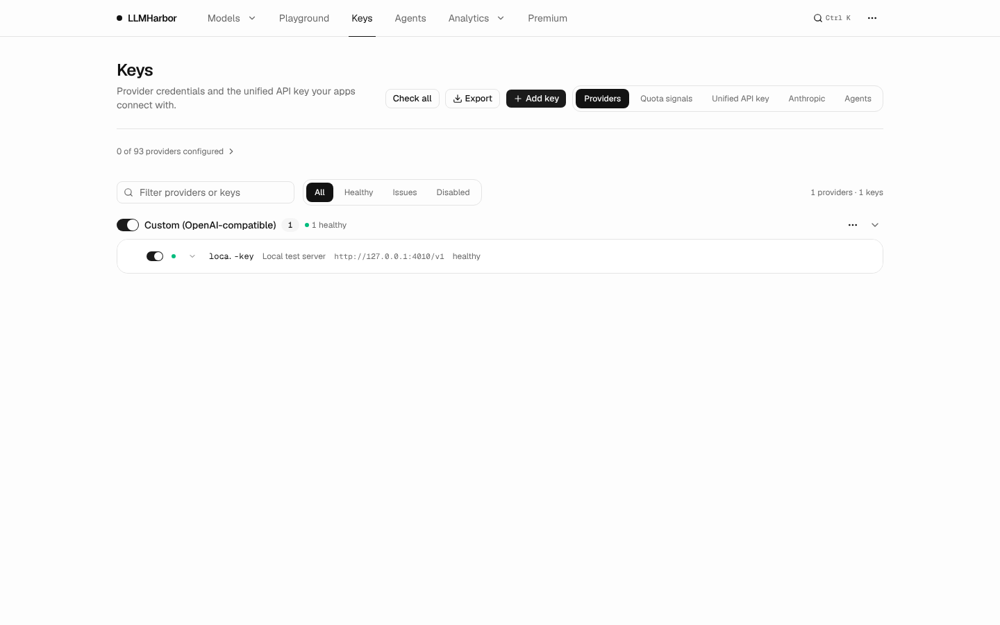

[English](../en/install.md) · **简体中文**

# 安装

LLMHarbor 是一个 Node.js 服务器，在同一个端口上提供 `/v1` API 和 React 仪表板。可以通过以下任一方式运行：

| 方式 | 默认地址 | 指南 |
| --- | --- | --- |
| 桌面版（Windows、macOS、Linux x64） | `http://127.0.0.1:31415` | [桌面版](desktop.md) |
| Windows 7 SP1 便携 ZIP | `http://127.0.0.1:31415` | [desktop/win7/README.md](../../desktop/win7/README.md)（英文） |
| 32 位 Intel Linux 服务器包 | `http://127.0.0.1:3001` | [desktop/linux-browser/README.md](../../desktop/linux-browser/README.md)（英文） |
| Android APK（Android 8.0+） | `http://127.0.0.1:31415` | [Android](android.md) |
| Docker Compose | `http://localhost:3001` | [Docker](docker.md) |
| 从源码运行（Node.js） | `http://localhost:3001` | 本页 |

预构建的安装包在 [GitHub Releases 页面](https://github.com/Zelvior-Labs/llmharbor/releases)。

## 从源码运行

### 环境要求

- Node.js `>=20.18.0 <25.0.0`，npm `>=10`（见 `package.json` 的 `engines` 字段）。
- 在大多数平台上，服务器通过可选依赖 `better-sqlite3`（原生扩展）打开 SQLite。如果 npm 无法为您的平台下载预编译
  文件，就会在本地编译，这需要 Python 3 和 C++ 工具链。

### 开发模式

```bash
git clone https://github.com/Zelvior-Labs/llmharbor.git
cd llmharbor
npm install
npm run dev
```

`npm run dev` 会在 3001 端口启动 API 服务器（`tsx watch`），并在 5173 端口启动 Vite 仪表板，修改代码后两者都会自动
重新加载。打开 <http://localhost:5173>。使用 `npm run dev:lan` 可让 Vite 仪表板同时监听局域网。

也可以运行 `./scripts/dev-bootstrap.sh`（Bash）或 `.\scripts\dev-bootstrap.ps1`（PowerShell）。它会检查 Node.js
和 npm 版本，仅在 `package-lock.json` 变化时运行 `npm install`，并在 `.env` 不存在时创建它。

### 生产构建

```bash
npm install
npm run build                 # 服务器、CLI 和仪表板
NODE_ENV=production ENCRYPTION_KEY=<64 位十六进制字符> node server/dist/index.js
```

构建后的服务器自己提供 `client/dist`，因此仪表板和 API 共用 3001 端口。`NODE_ENV=production` 时必须设置
`ENCRYPTION_KEY`，可以这样生成：

```bash
node -e "console.log(require('crypto').randomBytes(32).toString('hex'))"
```

非生产环境下可以不设置 `ENCRYPTION_KEY`，服务器会生成一个密钥并保存到数据库旁边的 `.encryption-key` 文件中。
参见[配置](configuration.md)。

### 数据位置

- 数据库默认是 `server/data/freeapi.db`，可用 `FREEAPI_DB_PATH` 修改。
- 迁移会在启动时自动执行；如果 `NODE_ENV` 设为 `development`，则需要自己运行 `npm run db:migration:up`。

## 首次运行

1. 打开仪表板并创建第一个账户（邮箱和密码）。
   - 在服务器所在机器的浏览器中操作时，不需要其他东西。
   - 从其他设备操作时，还需要一次性的**设置码**。在还没有账户时，服务器启动时会把它打印到日志中，查找
     `First-run setup code:` 这一行。
2. 打开 **Keys**，至少添加一个提供方密钥（部分提供方不需要密钥，见[提供方](providers.md)）。
3. 在 **Keys → Unified API key** 复制**统一 API 密钥**，它以 `llmharbor-` 开头。
4. 让客户端使用 `http://<主机>:<端口>/v1`，并把统一密钥作为 Bearer 令牌。参见 [API](api.md) 和
   [智能体与 CLI](agents.md)。

桌面版会自动登录自己的仪表板。通过局域网访问桌面版的设备仍然会看到登录表单。



<sub>添加了一个自定义端点的 Keys 页面。统一 API 密钥在 Unified API key 标签页中。</sub>

## 更新源码安装

```bash
git pull
npm install
npm run build
```

然后重启服务器，待执行的迁移会在下次启动时运行。
