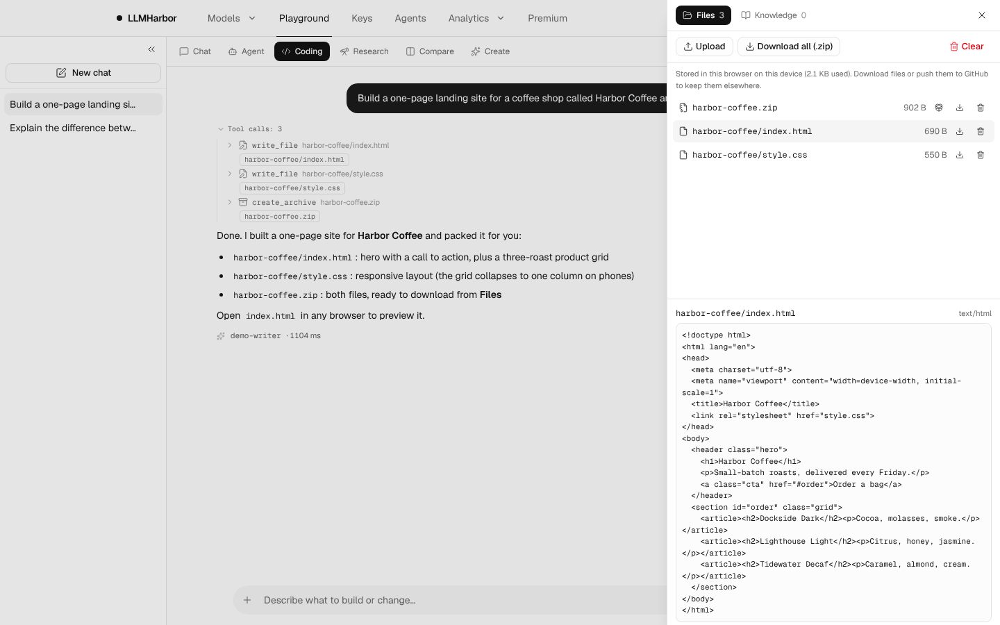
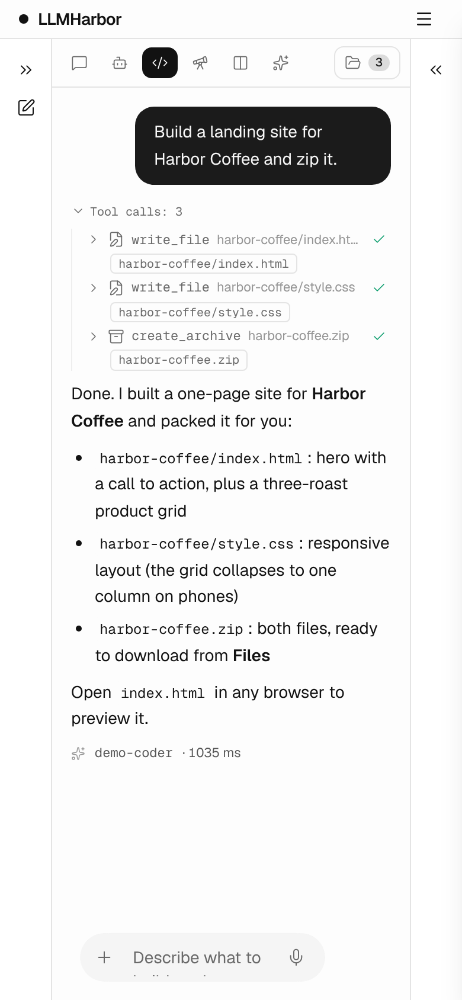
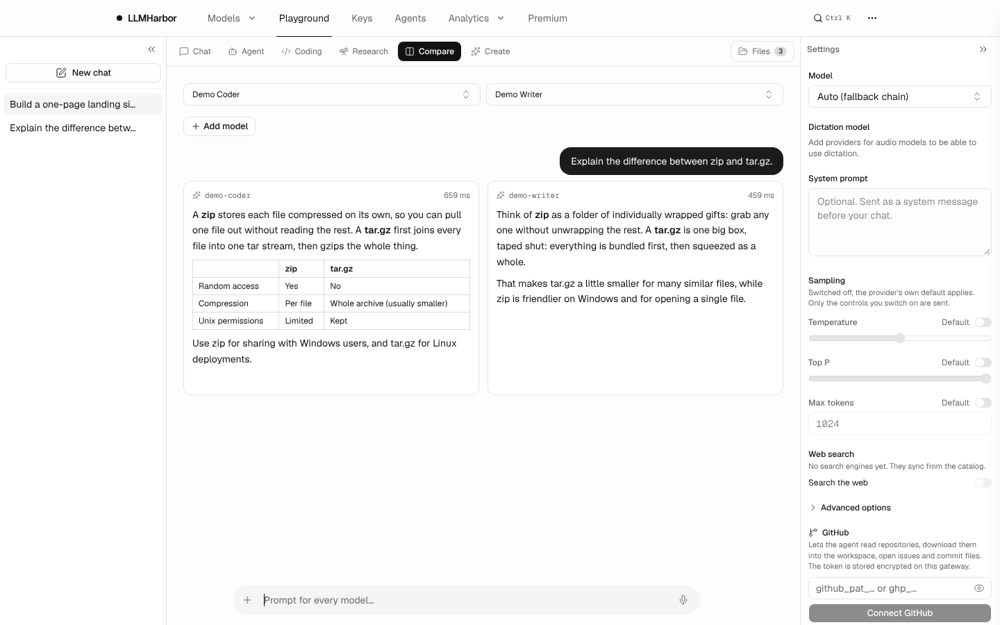

[English](../en/playground.md) · **简体中文**

# 试验台（Playground）

仪表板的 **Playground** 标签页用来和模型对话。对话记录上方有一排模式：普通对话、三种使用工具的智能体模式、并排对比，以及媒体创作。
每种模式都通过本网关自己的 `/v1` API 和统一密钥发送请求，因此路由、回退、配额和日志与任何其他客户端完全一致。

对话模式。模式栏位于对话记录上方，设置栏在右侧。

## 模式

| 模式 | 作用 |
| --- | --- |
| **对话** | 直接对话，每条消息发送一次 `/v1/chat/completions` 请求。这是默认模式，行为与以前的试验台相同：流式输出、推理、图片附件、网页搜索和 Fusion。 |
| **智能体** | 模型借助工具（见下文）逐步完成任务，最后给出总结。 |
| **编程** | 带有软件开发附加指令的智能体模式：先读后改、写出完整文件、保持合理的项目结构，在你要求或项目完成时用 `create_archive` 打包。 |
| **研究** | 带有研究附加指令的智能体模式：多次搜索网页、比较来源，并给出带编号引用的回答。你要求报告时，还会把报告保存到 `reports/`。 |
| **对比** | 把同一个提示词同时发给两到四个模型，并排流式显示它们的回答。 |
| **创作** | 直接根据提示词生成图片、视频或语音。 |

所选模式会记在浏览器中。打开已保存的对话时，试验台会切换到该对话最后一条智能体回答所用的模式，这样后续消息仍能使用工具。

### 选择模型或路由器

设置栏中的 **模型** 选择器对所有模式都有效，默认是 **自动（回退链）**：请求不带 `model` 字段，由路由器选择模型，并照常回退。
你也可以改选某个命名回退链、Fusion 或任意已启用的模型。这个选择只影响试验台，其他客户端发送的模型不受影响。

在 **对比** 模式中，每一列都有自己的选择器（默认是自动和 Fusion）。**添加模型** 可增加一列，最多四列。每个提示词单独发送，
不带之前的轮次。对比的结果不会保存到对话列表。

## 智能体模式

智能体、编程和研究模式在浏览器中运行工具循环。每一步是一次带工具定义的非流式 `/v1/chat/completions` 请求，模型要么调用工具，
要么给出回答。模型给出回答、你按下 **停止**，或达到 30 轮工具调用时，运行结束；达到上限时试验台会提示，你可以让它继续。

编程模式：每次工具调用都会列出参数和结果，点击文件标签即可打开文件。

每条回答都会显示它的工具调用（展开即可查看参数和结果），以及执行最后一步的模型。这些步骤随对话一起保存，重新打开对话时仍然可见。

工具调用需要支持它的模型。使用 **自动** 时，网关只会把带工具的请求路由到支持工具调用的模型；如果一个都没有启用，运行会失败，
并提示你去 **模型** 页面启用。

### 工具

| 工具 | 何时可用 | 作用 |
| --- | --- | --- |
| `list_files`、`read_file`、`write_file`、`edit_file`、`delete_file` | 始终 | 操作工作区中的文件。 |
| `create_archive`、`extract_archive` | 始终 | 在工作区中创建或解压 zip、tar 和 tar.gz 压缩包。 |
| `web_search` | 已设置网页搜索引擎 | 通过 `/v1/search` 搜索。 |
| `generate_image` | 已启用图片模型 | 调用 `/v1/images/generations`，图片保存到工作区。 |
| `generate_video` | 已启用视频模型 | 调用 `/v1/videos/generations`，MP4 保存到工作区。 |
| `text_to_speech` | 已启用语音模型 | 调用 `/v1/audio/speech`，音频保存到工作区。 |
| `search_knowledge` | 已添加知识文件 | 返回知识文件中最相关的段落。 |
| `github_request`、`github_download_repo`、`github_push_files` | 已连接 GitHub | 调用 GitHub REST API、把仓库下载到工作区、把工作区文件提交到某个分支。 |

只有能正常工作的工具才会提供给模型。尚未设置网页搜索引擎时，研究模式会显示提醒。

## 文件与工作区

智能体在 **工作区** 中工作：这是一个保存在本设备浏览器 IndexedDB 中的虚拟文件夹。点击模式栏末尾的 **文件** 打开它。

文件抽屉：预览、下载、解压、删除。知识文件有单独的标签页。

- **上传** 可添加你自己的文件。智能体写的文件、创建的压缩包，以及工具或创作模式生成的媒体也会出现在这里。
- 文本文件、图片、音频和视频可以在抽屉中预览。
- 每个文件都有下载按钮。**全部下载（.zip）** 会把整个工作区打包成一个 zip 下载。
- zip、tar 和 tar.gz 文件可以用 **解压到此处** 就地解压。
- 工作区最多容纳 2000 个文件、共 200 MB，单个文件最多 50 MB。

工作区不会同步。其他浏览器或设备有各自的工作区，清除仪表板的网站数据会删除它。如需保存到别处，请下载文件或推送到 GitHub。
对话本身仍像以前一样保存在服务器上。

## 知识文件

文件抽屉的 **知识** 标签页接收文本文件（每个最多 10 MB），智能体可以用 `search_knowledge` 搜索它们。每个文件会被切分成相互重叠的段落。
如果默认嵌入系列中有已启用且配置了密钥的提供方，这些段落会通过 `/v1/embeddings` 生成向量并按语义搜索；否则试验台改用关键词搜索，
并在添加文件时提示。知识文件和工作区一样保存在浏览器中。

## 创作模式

在对话记录上方选择 **图片**、**视频** 或 **语音**，然后输入提示词：

- **图片**：尺寸 1024x1024、1024x1792、1792x1024 或 512x512。
- **视频**：时长（秒）以及 16:9 或 9:16。生成视频可能需要几分钟。
- **语音**：可选音色。

结果保存在工作区（`images/`、`videos/`、`audio/`）并直接显示。在 **模型** 下的媒体页面启用对应模型之前，试验台会在对话记录上方显示提示。

## 设置栏新增项

- **高级选项**：随机种子、Top K、Min P、频率惩罚、存在惩罚、重复惩罚、最多四个停止序列、JSON 输出和推理强度。每一项只在打开时发送，
  不支持的提供方会忽略它。它们适用于对话、智能体模式和对比。
- **GitHub**：粘贴 GitHub 个人访问令牌后，智能体即可使用 GitHub 工具。令牌会先经 GitHub 验证，然后像提供方密钥一样加密保存在本网关上，
  不会再发回浏览器。浏览器本身不能调用 `api.github.com`（仪表板只与自己的源通信），所以由网关通过 `/api/playground/github`
  转发智能体的请求。转发只会访问 `api.github.com`，配置了出站代理时会经过代理，每个响应最多返回 25 MB。**断开连接** 会删除令牌。

## 手机与其他平台

一切都在仪表板页面中运行，所以只要能打开仪表板，就能使用试验台：桌面浏览器、桌面应用（包括 Windows 7 版本）以及手机浏览器。
在 Android 上，**Open dashboard** 会在手机浏览器中打开仪表板。在窄屏上模式栏只显示图标，下载使用浏览器自身的下载处理。

在 390 px 宽的手机屏幕上使用编程模式。

## 对比模式截图

对比模式：两列，每列流式显示各自模型的回答。
