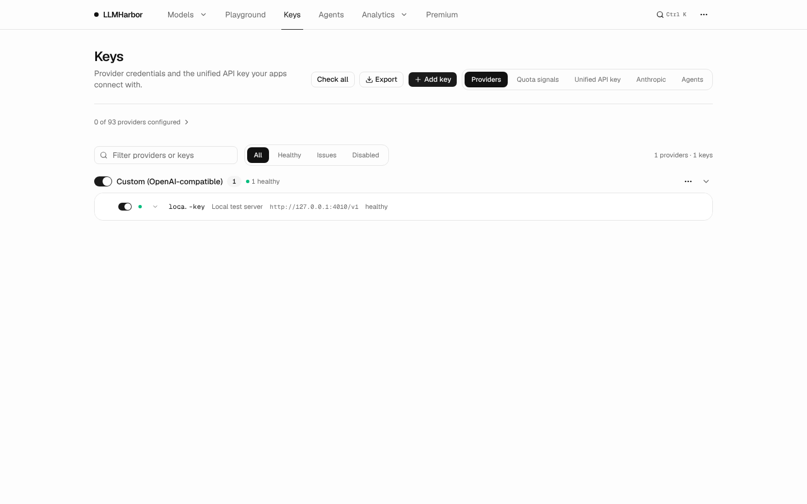

[English](../en/providers.md) · **简体中文**

# 提供方

*平台*是一个有名称的上游服务，例如 `groq` 或 `openrouter`。完整的平台 id 列表是
[`shared/types.ts`](../../shared/types.ts) 中的 `Platform` 类型，每个平台在
[`server/src/providers/`](../../server/src/providers) 中都有一个适配器。

在仪表板的 **Keys** 页面添加密钥，或在终端使用 `npm run cli -- keys add <platform>`（见
[智能体与 CLI](agents.md#提供方密钥)）。密钥以 AES-256-GCM 加密存储在 SQLite 中，可以启用、停用、限定到特定模型，
并进行健康检查。

## 聊天、媒体与决策提供方

下表根据 [`client/src/components/keys/shared.tsx`](../../client/src/components/keys/shared.tsx) 中的 `PLATFORMS`
列表生成，也就是 Keys 页面提供的选项；“仪表板标签”一列与仪表板显示的文字一致（英文）。免费额度由各提供方决定，
随时可能变化，依赖之前请查看提供方自己的页面。该文件中另有 `aclide` 和 `waterfall` 两个平台被标记为 `hidden`：
不再提供给新密钥，但已有的密钥仍可使用。

| 平台 id | 仪表板标签 | 密钥 / 注册页面 |
| --- | --- | --- |
| `agnes` | Agnes AI (free key) | <https://platform.agnes-ai.com> |
| `aihorde` | AI Horde (no key needed, slow) | <https://aihorde.net/register> |
| `ainative` | AINative Studio (free key) | <https://ainative.studio> |
| `aion` | Aion Labs (free key) | <https://www.aionlabs.ai> |
| `airforce` | Api.Airforce (daily free requests; 1 per minute) | <https://api.airforce> |
| `aisense` | AI SENSE (keyless decisions) | <https://www.aisense.no/free-public-api-decide-api-endpoint> |
| `anyapi` | AnyAPI (free key) | <https://anyapi.ai> |
| `apinex` | APINex (shared daily free chat and decisions) | <https://apinex.bond/keys> |
| `bai` | B.AI (promotional free model) | <https://b.ai> |
| `bazaarlink` | BazaarLink (free key) | <https://bazaarlink.ai> |
| `beatapi` | BeatAPI (JEV decisions; temporary free offer) | <https://beatapi.io> |
| `blaze` | BlazeAPI (daily free tokens; Discord verification) | <https://blazeapi.org/dashboard> |
| `blockrun` | BlockRun (zero-priced models) | <https://user.blockrun.ai/dashboard/keys> |
| `cartesia` | Cartesia (20K shared credits/month; non-commercial Free plan) | <https://play.cartesia.ai/keys> |
| `cerebras` | Cerebras | <https://cloud.cerebras.ai> |
| `clod` | CLōD (shared daily free requests) | <https://app.clod.io> |
| `cloudflare` | Cloudflare Workers AI | <https://dash.cloudflare.com> |
| `cohere` | Cohere | <https://dashboard.cohere.com/api-keys> |
| `dreamprompting` | DreamPrompting (rolling 24h free tokens and requests) | <https://dreamprompting.com> |
| `electronhub` | ElectronHub (shared weekly credits) | <https://app.electronhub.ai> |
| `experiential` | Experiential Labs (shared monthly credits) | <https://platform.experientiallabs.ai> |
| `freeai` | Free.ai (speech, transcription and embeddings) | <https://free.ai/account/#api-keys> |
| `freeinference` | FreeInference (research; requests logged) | <https://freeinference.org> |
| `freemodel` | FreeModel (monthly allowance; Telegram verification) | <https://freemodel.in/dashboard> |
| `freetts` | FreeTTS (personal use only; watermarked TTS) | <https://freetts.org/dashboard?section=api-keys> |
| `gizmo` | Gizmo (monthly free-model requests) | <https://gizmoplatforms.com/developers> |
| `google` | Google AI Studio | <https://aistudio.google.com/apikey> |
| `groq` | Groq | <https://console.groq.com/keys> |
| `halx` | HAL-X (keyless decisions) | <https://hal-x.ai> |
| `huggingface` | HuggingFace Router | <https://huggingface.co/settings/tokens> |
| `inferbase` | Inferbase (shared monthly and daily allowance) | <https://inferbase.ai> |
| `iteracompute` | IteraCompute (30M free tokens / month, shared) | <https://iteracompute.com/free/> |
| `jamai` | JamAI Base (monthly ELLM allowance) | <https://cloud.jamaibase.com> |
| `kenari` | Kenari (shared daily free chat and images) | <https://kenari.id> |
| `kilo` | Kilo Gateway (no key needed) | <https://app.kilo.ai> |
| `kiosapi` | KiosAPI (shared daily free chat) | <https://kiosapi.id/dashboard/keys> |
| `llm7` | LLM7 (anon ok) | <https://llm7.io> |
| `llmtr` | LLMTR (daily free-model quotas) | <https://llmtr.com> |
| `logfare` | Logfare (fair-use free models) | <https://logfare.ai> |
| `longcat` | LongCat (free daily, email signup ok) | <https://longcat.chat/platform> |
| `lucidity` | Lucidity Composite (daily free-model requests) | <https://composite.lucidity.sh> |
| `meldport` | Meldport (monthly free tokens) | <https://console.meldport.com> |
| `mistral` | Mistral | <https://console.mistral.ai/api-keys/> |
| `modelscope` | ModelScope (free key, needs Aliyun cn binding) | <https://modelscope.cn/my/myaccesstoken> |
| `moondream` | Moondream ($5 shared monthly credits) | <https://moondream.ai/c/cloud/api-keys> |
| `nabh` | nabh.cloud (50 shared monthly credits) | <https://app.nabh.cloud> |
| `nara` | NaraRouter (free key) | <https://router.bynara.id> |
| `navy` | NavyAI (free key) | <https://api.navy> |
| `novai` | NovAI (daily free chat + video quota) | <https://aiapi-pro.com> |
| `nvidia` | NVIDIA NIM | <https://build.nvidia.com/settings/api-keys> |
| `ollama` | Ollama Cloud | <https://ollama.com/settings/keys> |
| `onomeo` | onomeo (30 free calls / 5 hours, shared) | <https://onomeo.com/dashboard> |
| `opencode` | OpenCode Zen (paid models only) | <https://opencode.ai/auth> |
| `openrouter` | OpenRouter | <https://openrouter.ai/keys> |
| `orcarouter` | OrcaRouter (free key) | <https://www.orcarouter.ai> |
| `ovh` | OVH AI Endpoints (no key needed) | <https://endpoints.ai.cloud.ovh.net> |
| `plugsky` | Plugsky (free chat aliases) | <https://plugsky.com/dashboard> |
| `pollinations` | Pollinations | <https://enter.pollinations.ai> |
| `powertokens` | PowerTokens (free: glm-4.7-flash) | <https://www.powertokens.ai> |
| `qianfan` | Baidu Qianfan (free ERNIE, needs cn real-name) | <https://console.bce.baidu.com/qianfan/overview> |
| `radeon` | AMD Radeon Cloud (free shared models) | <https://developer.amd.com.cn/radeon/tokenfactory> |
| `reka` | Reka (prepaid credits) | <https://platform.reka.ai> |
| `requesty` | Requesty (free key) | <https://www.requesty.ai> |
| `rime` | Rime (shared monthly TTS / transcription credits) | <https://app.rime.ai> |
| `router9` | Router9 (shared monthly credits) | <https://www.router9.com> |
| `routeway` | Routeway (free key) | <https://routeway.ai> |
| `sail` | Sail Research ($5 monthly with payment method) | <https://app.sailresearch.com> |
| `sealion` | SEA-LION (free key) | <https://sea-lion.ai> |
| `septor` | Septor Labs (daily free-model quota) | <https://septorlabs.com/dashboard> |
| `siliconflow` | SiliconFlow (image + TTS) | <https://siliconflow.com> |
| `silvr` | SilvR AI ($3.50 shared daily allowance) | <https://dashboard.silvrai.net> |
| `simplellm` | SimpleLLM (shared hourly and daily free quota) | <https://app.simplellm.eu> |
| `speechflow` | SpeechFlow (file transcription) | <https://speechflow.io> |
| `speechify` | Speechify (monthly free TTS characters) | <https://platform.speechify.ai> |
| `speka` | Speka ($1 shared monthly credits) | <https://speka.me/dashboard/keys> |
| `typecast` | Typecast (15K credits/month; non-commercial, attribution required) | <https://studio.typecast.ai/developers/api> |
| `typhoon` | Typhoon (free research API) | <https://playground.opentyphoon.ai> |
| `unorouter` | UnoRouter (free key) | <https://unorouter.com> |
| `varosity` | Varosity (one-time $1.50 starter credit) | <https://varosity.ai/app/keys/api-keys> |
| `volcengine` | Volcengine Ark (free daily, needs cn real-name) | <https://console.volcengine.com/ark> |
| `xfyun` | iFlytek Spark (free Lite, needs cn real-name) | <https://console.xfyun.cn> |
| `xkiro` | xKiro (free key) | <https://xkiro.com> |
| `zhipu` | Zhipu AI (Z.ai) | <https://z.ai/manage-apikey/apikey-list> |
| `zro` | Zro / MoonMath.ai (shared daily free usage) | <https://zro.moonmath.ai/api-keys> |

有五个平台被标记为 `keyless`：Kilo、OVH、AI Horde、HAL-X 和 AI SENSE。添加它们时可以不填密钥（填写真实密钥也可以）。
全新安装会在第一次目录同步后，一次性启用目录中列出的免密钥提供方；已有的安装则会在 Keys 页面看到
**Enable all** 提示。

## 网页搜索提供方

它们为 `POST /v1/search` 和仪表板的 Search 页面提供服务，列表来自
[`client/src/lib/search.ts`](../../client/src/lib/search.ts)。

| 平台 id | 仪表板标签 | 密钥页面 |
| --- | --- | --- |
| `tavily` | Tavily (1,000 searches/month) | <https://app.tavily.com/home> |
| `exa` | Exa ($10 search credits/month) | <https://dashboard.exa.ai/api-keys> |
| `firecrawl` | Firecrawl (1,000 credits/month) | <https://www.firecrawl.dev/app/api-keys> |
| `linkup` | Linkup (€5 credits/month) | <https://app.linkup.so/api-keys> |
| `parallel` | Parallel (no key needed) | <https://platform.parallel.ai> |
| `serpsearch` | SerpSearch (1,000 searches/month) | <https://serpsearch.com/dashboard/api-keys> |
| `keenable` | Keenable (no key needed) | <https://keenable.ai> |
| `brave` | Brave Search (free monthly credits) | <https://api-dashboard.search.brave.com/app/keys> |
| `outcrawl` | Outcrawl (1,000 credits/month) | <https://outcrawl.ai/console/keys> |

## 自定义 OpenAI 兼容端点

`custom` 平台可以指向任何 OpenAI 兼容的基础 URL，例如 llama.cpp、LM Studio、vLLM、本地 Ollama 或另一个网关。在
Keys 页面填写基础 URL、可选的密钥以及它提供的模型即可添加。自定义模型的类型可以是：chat、embedding、image、audio、
transcription、search 或 decision。

云元数据地址和链路本地地址始终不能用作自定义基础 URL；回环和局域网地址默认允许，除非设置
`FREEAPI_BLOCK_PRIVATE_PROVIDER_URLS=true`。

Keys 页面上的一个自定义 OpenAI 兼容端点。

## 模型目录

各平台提供的模型由 [`server/src/db/migrations/`](../../server/src/db/migrations) 中的数据库迁移写入。在此基础上，
[`server/src/services/catalog-sync.ts`](../../server/src/services/catalog-sync.ts) 会在启动 10 秒后、之后每 12 小时，
从 `https://api.freellmapi.co/v1/latest` 获取一份签名目录：

- 响应会用内置的 Ed25519 公钥校验，未签名或被篡改的目录会被丢弃。
- 比构建中自带版本（`MIN_CATALOG_VERSION`）更旧的目录会被忽略，因此迁移始终是基线。
- 没有许可证密钥时，服务器收到的是免费的每月快照；有有效密钥（在仪表板的 **Premium** 页面输入）时，收到的是实时版本。许可证功能来自 freellmapi；LLMHarbor 没有付费方案，也不出售密钥。
- 请求只携带许可证密钥（如果设置了）和上次应用的目录版本，从不包含提示词、回复或提供方密钥。

设置 `CATALOG_SYNC_DISABLED=1` 可关闭同步，此时路由器只使用自带目录和您自己的修改。`CATALOG_BASE_URL` 和
`CATALOG_PUBKEY` 可让它使用另一个目录服务器。

## 添加提供方（贡献者）

1. 在 `shared/types.ts` 的 `Platform` 联合类型中添加 id。
2. 在 `server/src/providers/` 中编写适配器。大多数继承 `OpenAICompatProvider`（`openai-compat.ts`），其余继承
   `BaseProvider`（`base.ts`）。
3. 在 `server/src/providers/index.ts` 中注册。
4. 用一个新迁移写入它的模型（`npm run db:migration:create --name=<name>`）。
5. 把它加入 `client/src/components/keys/shared.tsx` 的 `PLATFORMS`。
6. 在 `server/src/__tests__/` 下添加测试。

只添加无需绑定支付卡即可免费使用的服务，见 [CONTRIBUTING.md](../../CONTRIBUTING.md)。
